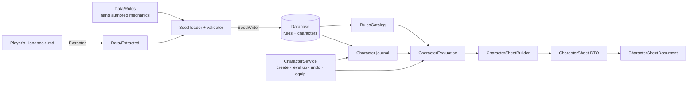
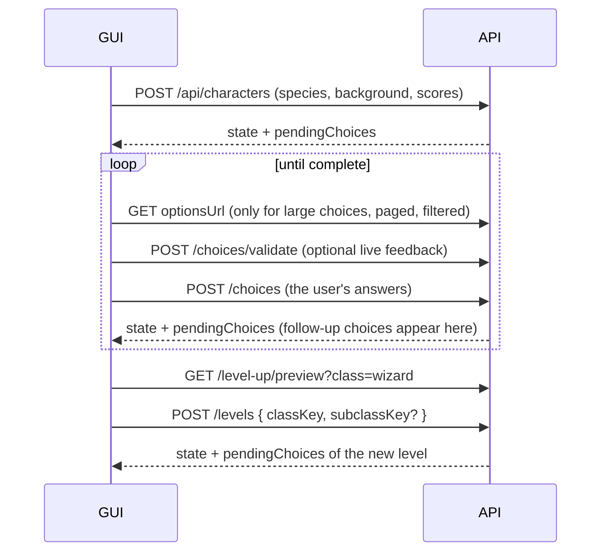

# TableTopSheets

A character builder and sheet generator for **D&D 5e (Player's Handbook 2024)**. The rules live in the database as data,
the engine computes a complete character sheet from them, and the PDF library prints it.

- **No C# in the database.** Every rule is data: features, effects, choices, class tables and small formulas.
- **A character is a journal of decisions.** It stores what the player chose: species, background, ability scores, each
  level up, and every selection made along the way. It also stores what they currently carry and wear.
- **Everything else is recalculated** from the rules and that journal on every request: ability scores, hit points,
  proficiencies, Armor Class, attacks, spell slots, prepared spells and features. Undoing a level up or taking off armor
  therefore never needs special "reverse" code.

---

## Contents

1. [Quick start](#quick-start)
2. [Solution layout](#solution-layout)
3. [How the character builder works](#how-the-character-builder-works)
4. [Choices](#choices) (with worked examples)
5. [Level up, multiclassing and undo](#level-up-multiclassing-and-undo)
6. [Equipment, toggles and Armor Class](#equipment-toggles-and-armor-class)
7. [Spellcasting](#spellcasting)
8. [REST API](#rest-api)
9. [Adding rule data](#adding-rule-data)
10. [Extending the engine](#extending-the-engine)
11. [Reference](#reference)

---

## Quick start

```bash
dotnet build TableTopSheets.slnx
dotnet test Tests/TableTopSheets.Engine.Tests    # engine, rules, undo, multiclass, equipment, PDF
dotnet test Tests/TableTopSheets.Api.Tests       # REST API end to end
```

The quickest way to try it is the REST API. It creates, migrates and seeds a local SQLite database on start:

```bash
dotnet run --project Api/TableTopSheets.Api      # Swagger UI at http://localhost:5180/swagger
```

The user interface is a React app in `Ui/` (pnpm); its dev server proxies `/api` to the API:

```bash
cd Ui && pnpm install && pnpm dev                # http://localhost:5173
```

`Api/TableTopSheets.Api/TableTopSheets.Api.http` walks through a whole character. See [REST API](#rest-api).

### Docker

`Api/TableTopSheets.Api/Dockerfile` builds the API and the user interface (from the repository root); the API serves
the built UI from its web root, so the website and `/api` share one origin. The compose files at the root run it with
one database configuration each; all of them extend the API service in `compose.api.yaml`:

| File                               | Database                                                              |
|------------------------------------|-----------------------------------------------------------------------|
| `compose.sqlite.yaml`              | SQLite file in the `sqlite-data` volume                               |
| `compose.postgresql.yaml`          | PostgreSQL 18 container (volume `postgres-data`, port `5432` on host) |
| `compose.postgresql-external.yaml` | An existing PostgreSQL server, connection string in `POSTGRES_CONNECTION` |

```bash
cp .env.example .env                             # set JWT_SIGNING_KEY (at least 32 characters)
docker compose -f compose.postgresql.yaml up --build    # UI at http://localhost:5180, Swagger UI at /swagger
```

The API migrates and seeds the database on start. Ports, credentials and authentication settings are read from `.env`.

Create a database and fill it with the rules:

```bash
# PostgreSQL – connection string in TABLETOPSHEETS_POSTGRESQL
export TABLETOPSHEETS_POSTGRESQL="Host=localhost;Database=tabletopsheets;Username=postgres;Password=..."
dotnet ef database update --project Persistence/TableTopSheets.Persistence.Postgresql
# (SQLite for local development: TABLETOPSHEETS_SQLITE, project TableTopSheets.Persistence.Sqlite)
```

```csharp
await using TableTopSheetsContext context = PostgresqlContextFactory.Create(connectionString);
await SeedWriter.SeedAsync(context);                          // repeatable; ids are deterministic
// characters belong to a user; ICurrentUser tells the service whose characters it may see
CharacterService service = new(context, new RulesCatalogLoader(context), currentUser);
```

Build a character and print it:

```csharp
Character hero = await service.CreateAsync(new CreateCharacterRequest
{
  Name = "Elaria",
  SpeciesKey = "elf",
  BackgroundKey = "sage",
  Abilities = new Dictionary<string, byte> { ["str"] = 8, ["dex"] = 14, ["con"] = 13, ["int"] = 15, ["wis"] = 12, ["cha"] = 10 },
  Selections =
  [
    new("sage.ability-scores", "int"), new("sage.ability-scores", "int"), new("sage.ability-scores", "con"), // +2 INT, +1 CON
    new("elf.elven-lineage", "high-elf"),
    new("elf.elven-lineage-ability", "int"),
    new("elf.keen-senses", "perception"),
    new("sage.languages", "elvish"), new("sage.languages", "draconic"),
    new("magic-initiate.list", "wizard", Ref: "mi"),             // origin feat of the Sage
    new("magic-initiate.wizard.cantrips", "light", ParentRef: "mi"),
    // ... remaining Magic Initiate selections
  ],
});

await service.LevelUpAsync(hero.Id, new LevelUpRequest
{
  ClassKey = "wizard",
  Selections = [ new("wizard.skills", "arcana"), new("wizard.skills", "history"), /* cantrips, spellbook ... */ ],
});

CharacterSheet sheet = await service.BuildSheetAsync(hero.Id);
new CharacterSheetDocument(sheet).GenerateCharacterSheetFile("elaria.pdf");
```

You don't have to know every choice key upfront. Ask the engine what's open:

```csharp
IReadOnlyList<PendingChoice> open = await service.PreviewLevelUpAsync(hero.Id, "wizard");
CharacterEvaluation evaluation = service.Evaluate(await service.LoadAsync(hero.Id));
foreach (PendingChoice pending in ChoiceService.Pending(evaluation))
{
  var options = ChoiceService.AvailableOptions(evaluation, pending.Choice, pending.Owner); // already filtered
}
```

---

## Solution layout

| Project | Purpose |
|---|---|
| `Common/TableTopSheets.Common` | Enums, ability/skill keys, the `CharacterSheet` DTO shared with the PDF library |
| `Persistence/TableTopSheets.Persistence` | EF Core entities, configuration, `TableTopSheetsContext` |
| `Persistence/…Postgresql` / `…Sqlite` | Database providers, design-time factories, migrations |
| `Engine/TableTopSheets.Engine` | Expression language, rule evaluation, choices, sheet builder, `CharacterService` |
| `Seed/TableTopSheets.Seed` | Rule data as JSON (`Data/Extracted`, `Data/Rules`), loader, validator hookup, database writer |
| `Tools/TableTopSheets.Extractor` | Reads the Player's Handbook markdown and generates `Data/Extracted` |
| `Pdf/Library` | PDF rendering (PDFsharp); `CharacterSheetDocument` prints a `CharacterSheet` |
| `Api/TableTopSheets.Api` | ASP.NET Core minimal API: rules catalog, characters, the choice loop, level up, sheet and PDF |
| `Tests/TableTopSheets.Engine.Tests` | Tests for everything above, including migrations and PDF output |
| `Tests/TableTopSheets.Api.Tests` | End to end tests of the REST API (`WebApplicationFactory`, in-memory SQLite) |
| `Ui` | User interface: React, TypeScript, Vite, Chakra UI v3 and SCSS, pnpm; light and dark mode (see `Ui/README.md`) |
| `.claude/agents/pdf-library.md` | Claude Code sub agent specialised on the PDF library |
| `.claude/agents/user-interface.md` | Claude Code sub agent for the user interface: API reference, authentication, creation and level up workflows |



---

## How the character builder works

### Rules: everything is a *feature*

A **feature** is anything that gives a character something: a class feature ("Extra Attack"), a subclass feature, a
species trait ("Darkvision"), a background benefit, a feat, an invocation, the properties of a magic item, or the effect
of a spell you can switch on (Mage Armor).

A feature carries four kinds of mechanics:

| Part | What it does | Example |
|---|---|---|
| **Effect** | changes a value while the feature is active | Tough: `hp.perLevel` **Add** `2` |
| **Choice** | asks the player to pick something | Keen Senses: pick 1 of Insight, Perception, Survival |
| **Resource** | a limited-use pool | Second Wind: `scale('fighter.second-wind')` uses, d10, short rest |
| **Spellcasting** | makes the character a caster | Wizard Spellcasting: INT, full caster, spellbook |

Each feature has an owner (class, subclass, species, background, feat, item, spell, or *option*) and, for class
features, the class level at which it unlocks.

### Effects in detail

An effect targets a **stat key** and has an **operation**:

```json
{ "target": "ac.base", "op": "Candidate", "value": "10 + mod('dex') + mod('wis')",
  "condition": "!wearing('armor') && !wielding('shield')", "label": "Unarmored Defense (Monk)" }
```

| Operation | Meaning | Example |
|---|---|---|
| `Add` | adds; effects with the same `stackGroup` don't stack (only the highest counts) | Extra Attack from two classes |
| `Set` | replaces the default (the highest Set wins) | species speed 30, Wood Elf 35 |
| `Max` / `Min` | raises / lowers the final value | Body and Mind: DEX max 25 |
| `Proficiency` | proficiency level, the highest wins: `half`, `proficient`, `expertise` | `skill.arcana.prof` = `expertise` |
| `Grant` | yes/no flag | `proficiency.armor.heavy`, `damage.resist.fire`, `language.elvish` |
| `Candidate` | an alternative formula; only one applies (best, or the player's pick) | Armor Class calculations |

`condition` is re-evaluated on every calculation. That's why taking off armor or picking up a shield immediately changes
Unarmored Defense, Martial Arts and Unarmored Movement.

### Evaluation: from journal to sheet

`CharacterEvaluation` is created for every request. It computes:

1. **Levels:** class levels, the first class (for multiclass proficiency rules) and the chosen subclasses.
2. **Active features:**
   - species, background and origin feat features
   - class and subclass features up to the current class level
   - equipped (and attuned) item features
   - toggled spell effects
3. **Selections:** for every active feature, the stored selections of its choices. A selection can **grant further
   features** (a feat, an invocation, an Elven Lineage). Their choices are collected too, until nothing new appears.
4. **Effects:** all effects of active features, plus the effects of every selection, with `$option` / `$value` filled in.
5. **Stats are computed lazily.** `stat('ac.bonus')` gathers its effects, evaluates their conditions and formulas, and
   caches the result. Formulas may reference other stats (`mod('dex')` → `ability.dex.score`), and circular references
   are reported.

`CharacterSheetBuilder` then turns the evaluation into the printable `CharacterSheet`:
- abilities and skills
- AC, HP and hit dice
- initiative, speed and senses
- attacks (weapons, unarmed strike, damaging cantrips)
- proficiencies and languages
- spellcasting, slots and the spell list
- features grouped by sheet section
- resources and equipment

It also runs `ViolationChecker` and lists rule problems as **violations** instead of failing: open choices, too many
prepared spells, armor without training, more than 3 attuned items, and so on.

### Formulas (expressions)

Values, conditions, choice counts, filters and prerequisites are short expressions stored as text:

```
10 + mod('dex') + mod('wis')                 classLevel('warlock') >= 5 && chosen('eldritch-invocation.pact-of-the-blade')
scale('warlock.invocations')                 onList('wizard') && option.level >= 1 && option.level <= maxSpellLevel('wizard')
max(1, mod('cha'))                           !wearing('armor') && !wielding('shield')
```

The full list of functions is in the [reference](#expression-language). Every expression in the data is parsed and
checked when seeding (`CatalogValidator`), including references to unknown stats, scales, classes, features or spells.

---

## Choices

A **choice** belongs to a feature and asks the player to select something while that feature is active. It is defined by:

| Field | Meaning |
|---|---|
| `count` | how many selections, as an expression: `2`, `scale('wizard.cantrips')`, `2 * (classLevel('wizard') - 1)` |
| `source` | where options come from: `Static` (listed in the choice), `Ability`, `Skill`, `Tool`, `Language`, `Spell`, `Feat`, `FeatureCategory` (e.g. all invocations), `Item`, `Weapon` |
| `filter` | which options are allowed, evaluated per option (`option.key`, `option.level`, `onList(...)` …) |
| `allowDuplicates` / `maxPerOption` | whether the same option may be picked more than once, and how often |
| `effects` | applied **once per selection**; `$option` is the selected key, `$value` the value of a static option |
| `replace` | `Never`, `OneOnLevelUp` (swap one when leveling that class), `OnLongRest` / `OnShortRest` (change in place) |
| `optional` | the character sheet is complete without it |

When an option is itself a feat or a feature (Feat, FeatureCategory, or a static option with `feature` / `grants`), the
selected thing becomes an **active feature**. Its own effects and choices apply too. This is how nested decisions work.

The engine enforces:
- the count
- the filter
- option prerequisites (feat or invocation prerequisites)
- duplicate rules
- non-repeatable feats
- spells you already know for the same class and purpose

The examples below are the real data from `Seed/TableTopSheets.Seed/Data`.

### Example 1: pick one of three (Elf, Keen Senses)

> *You have proficiency in the Insight, Perception, or Survival skill.*

```json
{ "key": "elf.keen-senses",
  "choices": [{
    "key": "elf.keen-senses", "name": "Keen Senses", "count": "1", "source": "Skill",
    "filter": "oneOf(option.key, 'insight', 'perception', 'survival')",
    "effects": [{ "target": "skill.$option.prof", "op": "Proficiency", "value": "proficient" }]
  }]
}
```

The source is all skills, and the filter narrows it to three. Selecting `perception` creates the effect
`skill.perception.prof = proficient`. For "pick **two** of three", change `count` to `2`. Duplicates are not allowed by
default, so the player must pick two different skills.

### Example 2: +2/+1 or +1/+1/+1 from three abilities (Background)

> *Increase one of these scores by 2 and another one by 1, or increase all three by 1.*

```json
{ "key": "acolyte.ability-scores", "name": "Ability Score Increases",
  "count": "3", "source": "Ability",
  "filter": "oneOf(option.key, 'int', 'wis', 'cha')",
  "allowDuplicates": true, "maxPerOption": 2,
  "effects": [{ "target": "ability.$option.score", "op": "Add", "value": "1", "label": "Acolyte" }] }
```

Each selection is worth +1. Three selections with at most two on the same ability allow exactly the two legal patterns:

| Selections | Result |
|---|---|
| `wis`, `wis`, `int` | WIS +2, INT +1 ✔ |
| `int`, `wis`, `cha` | +1 each ✔ |
| `wis`, `wis`, `wis` | rejected: `maxPerOption` is 2 ✘ |
| `str`, … | rejected: not in the filter ✘ |

The ability maximum of 20 is applied automatically, because `ability.*.max` defaults to 20.

### Example 3: Ability Score Improvement, a choice inside a choice

At Wizard level 4 the class feature lets the player pick a **feat**. Picking the *Ability Score Improvement* feat opens a
**second choice** (which abilities).

```json
// class feature (Data/Rules/classes/wizard.json)
{ "key": "wizard.ability-score-improvement-4", "name": "Ability Score Improvement", "level": 4,
  "choices": [{ "key": "wizard.ability-score-improvement-4", "name": "Feat", "count": "1",
                "source": "Feat", "filter": "option.category == 'general'" }] }

// the feat (Data/Rules/feats.json)
{ "key": "ability-score-improvement",
  "features": [{ "key": "feat.ability-score-improvement",
    "choices": [{ "key": "ability-score-improvement.abilities", "name": "Ability Score Increases",
                  "count": "2", "source": "Ability", "allowDuplicates": true, "maxPerOption": 2,
                  "effects": [{ "target": "ability.$option.score", "op": "Add", "value": "1" }] }] }] }
```

- The filter offers every General feat. The feat's own prerequisite (`level >= 4`, `score('cha') >= 13` …) hides feats
  the character doesn't qualify for.
- "+2 to one score" is `int`, `int`. "+1 to two scores" is `int`, `wis`.
- The feat is **repeatable**, so the same choice exists again at levels 8, 12 and 16. Each instance is kept apart by its
  **parent**: the ability selections point to the feat selection they belong to (`CharacterChoice.ParentId`).

In a request, connect the nested selection to its parent with `Ref` / `ParentRef`:

```csharp
await service.LevelUpAsync(id, new LevelUpRequest
{
  ClassKey = "wizard",
  Selections =
  [
    new("wizard.ability-score-improvement-4", "ability-score-improvement", Ref: "asi"),
    new("ability-score-improvement.abilities", "int", ParentRef: "asi"),
    new("ability-score-improvement.abilities", "int", ParentRef: "asi"),
  ],
});
```

Choosing a different feat instead, such as *Resilient*, opens that feat's choice: one ability that gets +1 **and**
saving throw proficiency.

```json
"effects": [ { "target": "ability.$option.score", "op": "Add", "value": "1" },
             { "target": "save.$option.prof", "op": "Proficiency", "value": "proficient" } ]
```

### Example 4: options that grant features (Elven Lineage)

> *Choose Drow, High Elf or Wood Elf … choose Intelligence, Wisdom or Charisma as your spellcasting ability.*

```json
{ "key": "elf.elven-lineage", "name": "Elven Lineage", "source": "Static", "options": [
    { "key": "wood-elf", "name": "Wood Elf", "feature": {
        "key": "elf.lineage.wood-elf", "name": "Wood Elf Lineage",
        "effects": [ { "target": "speed.walk", "op": "Set", "value": "35" },
                     { "target": "spell.druidcraft", "op": "Grant" },
                     { "target": "spell.longstrider", "op": "Grant", "condition": "level >= 3" },
                     { "target": "spell.pass-without-trace", "op": "Grant", "condition": "level >= 5" } ] } },
    { "key": "drow", ... }, { "key": "high-elf", ... } ] },
{ "key": "elf.elven-lineage-ability", "name": "Lineage Spellcasting Ability", "source": "Ability",
  "filter": "oneOf(option.key, 'int', 'wis', 'cha')" }
```

- The selected option's inline `feature` becomes active.
- The lineage spells depend on the **character level** (`level`), not a class level.
- Spells granted this way use the ability chosen in the same feature, or in the feature above it.

### Example 5: an option carries a value (Draconic Ancestry)

```json
{ "key": "dragonborn.draconic-ancestry", "source": "Static",
  "options": [ { "key": "red", "name": "Red", "value": "fire" }, { "key": "white", "name": "White", "value": "cold" }, ... ],
  "effects": [ { "target": "damage.resist.$value", "op": "Grant" } ] }
```

`$option` is the option key (`red`), and `$value` is the option's value (`fire`). The result is
`damage.resist.fire`.

The same technique makes the *Skilled* feat work ("any combination of three skills or tools"). Each static option's value
is the stat to train, such as `skill.stealth.prof` or `proficiency.tool.thieves-tools`, and the single effect is
`{ "target": "$value", "op": "Proficiency", "value": "proficient" }`.

### Example 6: count from the class table, prerequisites, swapping (Eldritch Invocations)

```json
{ "key": "warlock.invocations", "source": "FeatureCategory", "category": "eldritch-invocation",
  "count": "scale('warlock.invocations')", "replace": "OneOnLevelUp" }
```

- **Count from the class table:** `warlock.invocations` is a table column (1, 3, 3, 3, 5, …). When the number grows on a
  level up, the new level has open selections.
- **Options are features:** every invocation is a feature in the `eldritch-invocation` category, with its own
  prerequisite, e.g. Thirsting Blade:

  ```json
  { "key": "eldritch-invocation.thirsting-blade",
    "prerequisite": "classLevel('warlock') >= 5 && chosen('eldritch-invocation.pact-of-the-blade')",
    "effects": [ { "target": "attack.extraAttacks", "op": "Add", "value": "1", "stackGroup": "extra-attack" } ] }
  ```

- **Swapping:** with `OneOnLevelUp`, a Warlock level up may replace one invocation
  (`new ReplacementRequest(selectionId, "eldritch-invocation.eldritch-mind")`). The old selection is marked as replaced,
  not deleted, so undoing that level brings it back.

### Example 7: a filter that depends on the character (Wizard Scholar)

> *Choose one of these skills in which you have proficiency … you have Expertise.*

```json
"filter": "oneOf(option.key, 'arcana', 'history', 'investigation', 'medicine', 'nature', 'religion') && skillProficiency(option.key) >= proficient",
"effects": [ { "target": "skill.$option.prof", "op": "Proficiency", "value": "expertise" } ]
```

### Example 8: spell choices

The choice `category` decides what a selected spell means:

| `category` | Meaning | Example |
|---|---|---|
| `cantrip` | known cantrip of that class | `wizard.cantrips`, count `scale('wizard.cantrips')` |
| `spellbook` | written into the spellbook | `wizard.spellbook-initial` (6), `wizard.spellbook` (`2 * (classLevel('wizard') - 1)`) |
| `prepared` | prepared list of a class that changes it on level up | `sorcerer.prepared`, `warlock.prepared` |
| *(none)* | always prepared, granted | Magic Initiate, Pact of the Tome |

Wizards, Clerics and Druids prepare from a long-rest **loadout** instead (`SetPreparedSpellsAsync`), validated against the
prepared count, the highest spell level and the spellbook or class list.

### Answering choices: the API

| Situation | Call |
|---|---|
| what's open right now | `ChoiceService.Pending(evaluation)` |
| what may be picked | `ChoiceService.AvailableOptions(evaluation, choice, owner)` |
| what a level up will ask | `PreviewLevelUpAsync(characterId, classKey)` |
| answer during creation / level up | `SelectionRequest(choiceKey, optionKey, Ref, ParentRef)` |
| answer later (belongs to the latest level) | `SelectAsync(characterId, selections)` |
| check without saving | `ValidateSelectionsAsync` / `ValidateLevelUpAsync` (dry run, project the evaluation) |
| take a selection back (latest level only) | `DeselectAsync(characterId, selectionId)` |
| why an option is not available | `ChoiceService.EvaluateOptions(evaluation, choice, owner)` (option + reason) |
| swap on level up (`OneOnLevelUp`) | `ReplacementRequest(selectionId, newOptionKey)` |
| change after a rest (`OnLongRest`/`OnShortRest`) | `ReplaceOnRestAsync(characterId, selectionId, newOptionKey)` |

Selections are applied **one at a time**, each validated against a fresh evaluation that already contains the previous
ones. This is what makes the nested choice from example 3 work in a single request, and why a count that depends on
another selection is always correct.

---

## Level up, multiclassing and undo

`LevelUpAsync(characterId, LevelUpRequest)` runs these steps:

1. **Multiclass check:** when adding a new class, the character needs 13+ in the primary ability of every current class
   and of the new one. Fighter needs STR **or** DEX, Monk needs DEX **and** WIS.
2. **Subclass:** required exactly at the class's subclass level.
3. **Swaps:** at most one per `OneOnLevelUp` choice, and only for choices of the class being leveled.
4. **Selections**, as described above.
5. **Completeness:** required choices that are still open reject the request, unless `AllowIncomplete`.

If anything fails, nothing is saved and the in-memory character is restored.

**Multiclass rules handled by data and engine:**

- Features have a `grantMode`. `FirstClassOnly` covers starting saving throws and full proficiencies. `MulticlassOnly`
  covers the reduced proficiencies, e.g. Fighter as a second class: light and medium armor, shields, martial weapons.
- Hit points: the maximum hit die only at character level 1, then the fixed average (or a stored roll) of the class
  taken at each level. The Constitution modifier applies to all levels.
- The proficiency bonus uses the character level.
- Spell slots come from the combined caster level. Full casters count all levels, half casters half rounded up, third
  casters a third rounded down. A single caster uses its own table, and Pact Magic stays separate.
- Extra Attack doesn't stack, because of the `extra-attack` stack group.

**Class level vs character level:**

| Uses the class level | Uses the character level |
|---|---|
| when class/subclass features unlock | proficiency bonus |
| class table columns (`scale('wizard.cantrips')`), `classLevel('x')` | `level`, feat prerequisites |
| highest spell level a class can prepare (`maxSpellLevel`) | species traits ("at character level 5") |
| which class may swap choices on level up | tables without a class (Dragonborn Breath Weapon) |
| hit die per level | cantrip damage (Fire Bolt 2d10 at character level 5) |

**Undo** (`UndoLastLevelAsync`) removes only the highest level:
- Every selection made with that level is deleted, including selections given later via `SelectAsync`.
- Selections it replaced become active again.
- Everything is recalculated.
- If a loadout becomes illegal (e.g. more prepared spells than allowed), it is **reported** as a violation and nothing is
  silently deleted.

The database enforces the same: deleting a level cascades to its selections and clears `SupersededByLevelId`.

---

## Equipment, toggles and Armor Class

- **Items:** `AddItemAsync`, `EquipAsync(characterItemId, EquipSlot)` (Armor, MainHand, OffHand, Worn, Ready, None) and
  `AttuneAsync` (maximum 3).
- **Equipped weapons:** any number of weapons can be `Ready` (equipped, not held); armor and each hand hold one item.
  Taking a weapon into an occupied hand puts the weapon held there back to `Ready`. The sheet lists the equipped weapons
  (ready or in hand) as attacks.
- **Coins and trading:** `AddItemAsync(…, purchase: true)` pays the item's cost from the coins, `RemoveItemAsync` removes
  a whole stack or part of it and, when selling, credits half of the cost. `Purse` pays with change (coins from the lowest
  value up; one larger coin is broken when needed) and credits in gold, silver and copper; too few coins are a rule
  violation. `SetCoinsAsync`, `ChangeCoinsAsync` (per kind) and `PayAsync` (an amount in copper) change the coins directly.
- **Armor rules are built in:**
  - base AC + DEX up to the armor's cap
  - Speed −10 if Strength is below the armor's requirement
  - Stealth Disadvantage
  - without training: Disadvantage on STR/DEX tests and no spellcasting (reported as a violation)
  - a shield only adds AC with shield training
- **Only one base AC formula applies.** Armor, unarmored (10 + DEX) and every `Candidate` effect (Unarmored Defense,
  Draconic Resilience, Mage Armor) are compared, and the best wins. `ChooseArmorClassAsync(label)` lets the player pick
  one instead. `ac.bonus` effects (shield, Defense style, Shield spell) add on top.
- **Toggles:** features marked `toggleable` (Innate Sorcery, Dragon Wings, Draconic Flight) and spell effects (Mage Armor,
  Shield, Shield of Faith) only apply while switched on with `ToggleAsync`.
- **Magic items** are items with features. A feature can require attunement (`attunement: true`), which means it only
  applies when the item is equipped and attuned.

---

## Spellcasting

Every spellcasting feature has a **spellcasting profile**. The differences between classes are just different values:

| | Wizard | Sorcerer | Warlock | Eldritch Knight |
|---|---|---|---|---|
| ability | `int` | `cha` | `cha` | `int` |
| progression | Full | Full | **Pact** | **Third** |
| slot table | multiclass | multiclass | `pact` | `eldritch-knight` |
| spell list | wizard | sorcerer | warlock | wizard |
| pool | **Spellbook** | ClassList | ClassList | ClassList |
| prepared spells change | Long rest (loadout) | Level up (choice) | Level up (choice) | Level up (choice) |
| rituals | from spellbook | – | – | – |

The sheet shows each class's spellcasting ability, save DC and attack bonus, the slots (Pact slots marked as short rest),
and the spell list. That list holds cantrips, prepared and always-prepared spells, and rituals castable from the spellbook.

---

## REST API

`Api/TableTopSheets.Api` exposes everything above over HTTP. A client never needs to know the rules. It shows what the
API says is open, sends the user's answers and shows the next state.

### Running and configuration

```bash
dotnet run --project Api/TableTopSheets.Api
```

| Setting | Default | Meaning |
|---|---|---|
| `Database:Provider` | `Sqlite` | `Sqlite` or `Postgresql` |
| `ConnectionStrings:TableTopSheets` | – | falls back to `TABLETOPSHEETS_SQLITE` / `TABLETOPSHEETS_POSTGRESQL`, then `Data Source=tabletopsheets.db` |
| `Database:MigrateOnStartup` | `true` | apply EF migrations on start |
| `Database:SeedOnStartup` | `true` | write the rules seed on start (idempotent upsert) |

The rules catalog is loaded once on startup and shared. A request gets its own `TableTopSheetsContext` and
`CharacterService`.

### Users and authentication

Every character belongs to a user (`Users` table, `Characters.OwnerId`). All `/api/characters/**` endpoints need an
`Authorization: Bearer <token>` header and only see the characters of that user. Another user's character answers
**404**, and a missing or invalid token answers **401**. `/api/rules` stays anonymous.

`Authentication:Provider` chooses the implementation of `IAuthenticationProvider` (`Api/TableTopSheets.Api/Authentication`):

| Provider | Sign in | Users |
|---|---|---|
| `Database` (default) | `POST /api/auth/register`, `POST /api/auth/login` return a JWT signed by the API | stored with a salted PBKDF2 hash (`PasswordHasher`) |
| `Oidc` | at the identity provider (Keycloak, Entra ID, Auth0 …); the API validates its access tokens | created on the first request and matched by `iss` + `sub` |

| Setting | Default | Meaning |
|---|---|---|
| `Authentication:Provider` | `Database` | `Database` or `Oidc` |
| `Authentication:Jwt:SigningKey` | – | at least 32 characters; required outside Development (Development generates one per start) |
| `Authentication:Jwt:Issuer` / `Audience` / `Lifetime` | `TableTopSheets` / `TableTopSheets` / `08:00:00` | tokens issued by the database provider |
| `Authentication:Database:MinimumPasswordLength` | `8` | |
| `Authentication:Database:AllowRegistration` | `true` | map `POST /api/auth/register` |
| `Authentication:Oidc:Authority` | – | issuer url of the identity provider (keys come from its discovery document) |
| `Authentication:Oidc:Audience` | – | expected `aud` (not checked when empty) |
| `Authentication:Oidc:UserNameClaim` / `EmailClaim` | `preferred_username` / `email` | used when the user row is created |

`GET /api/users/me` returns the signed in user. In the Swagger UI, **Authorize** takes the token.

### The choice loop



1. **Everything is a draft.** Creating a character and gaining a level save what was sent, even when choices are still
   open (`allowIncomplete` is `true` by default). Every write answers with the character's **state**: summary, abilities,
   HP, AC, items, `complete`, `pendingChoices` and `violations`.
2. **Pending choices describe themselves**, so a GUI can render any of them without special code:

   | Field | Use |
   |---|---|
   | `input` | `SingleSelect` (radio / dropdown), `MultiSelect` (checkboxes), `Distribution` (counters per option: background +2/+1, ASI) |
   | `constraints` | `min`, `max`, `maxPerOption`, `allowDuplicates`, and for distributions the `allowedPatterns`, e.g. `[[2,1],[1,1,1]]` |
   | `optionSource` | `Ability`, `Skill`, `Spell`, `Feat`, `Static` …; lets a GUI pick a richer widget, e.g. a spell picker |
   | `options` | embedded when there are at most 30 options |
   | `optionsUrl`, `optionCount`, `optionFilters` | for larger choices (spells, feats): the paged option list and the filters it accepts |
   | `parentRef` | send it back with the selection; it says which instance of the choice is meant |
   | `selectedOptions` | what was already picked for this instance (with selection ids) |
   | `source`, `description` | where the choice comes from, e.g. "Ability Score Improvement (Wizard 4)" |

   Each option has `key`, `name`, `summary`, `grants` (features the option gives, such as Elven Lineage → Drow Lineage)
   and typed `meta` (spell level, school, ritual, feat category, prerequisite …). With `includeDisabled=true` the options
   endpoint also lists options that exist but can't be taken right now, with a `disabledReason` such as "Prerequisite not
   met", "Already selected" or "The spell is already known".
3. **Follow-up choices.** Picking the *Ability Score Improvement* feat makes `ability-score-improvement.abilities` (a
   `Distribution`) appear in the next state, with the `parentRef` to use. A client that knows the follow-up ahead of time
   can send both in one request with `ref` / `parentRef` (see [example 3](#example-3-ability-score-improvement-a-choice-inside-a-choice)).
4. **Validate before saving.** `POST /choices/validate` and `POST /levels/validate` take the same body as the real call.
   They return `{ valid, errors, state }` and change nothing. The returned state already shows the follow-up choices.
5. **Errors.** Rule violations are **422** problem details whose `errors.rules` holds the engine messages, e.g.
   `'actor' is not an available option for 'Feat' (Prerequisite not met)`. Unknown characters are **404**. Bad query
   parameters or bodies are **400**.

### Endpoints

| Method | Route | Purpose |
|---|---|---|
| POST | `/api/auth/register`, `/api/auth/login` | database authentication: create a user / sign in; both return `{ accessToken, expiresAt, user }` |
| GET | `/api/users/me` | the signed in user and the number of their characters |
| GET | `/api/rules/{species,backgrounds,classes,feats,spells,items}` | catalog lists (paged, filterable) |
| GET | `/api/rules/{…}/{key}` | details: full text, features with their choice definitions; classes with features per level and subclasses |
| GET / POST | `/api/characters` | list of the user's characters (filter `class`, `species`, `minLevel`, `maxLevel`) / create a draft |
| GET / PATCH / DELETE | `/api/characters/{id}` | state / name, alignment, appearance, backstory, experience / delete |
| GET | `/api/characters/{id}/sheet`, `/sheet.pdf` | the computed `CharacterSheet` / the printable PDF |
| GET / POST | `/api/characters/{id}/choices` | pending choices / answer them |
| POST | `/api/characters/{id}/choices/validate` | dry run of the selections |
| GET | `/api/characters/{id}/choices/{choiceKey}/options` | options of a choice instance (`parentRef`, `preview`, filters, `includeDisabled`, `includeDescriptions`) |
| GET | `/api/characters/{id}/selections` | active selections with ids, level, `removable` |
| DELETE | `/api/characters/{id}/selections/{selectionId}` | take back a selection of the latest level, together with the selections that depend on it |
| POST | `/api/characters/{id}/selections/{selectionId}/rest-replace` | change a selection on a rest (Wizard cantrip swap …) |
| GET | `/api/characters/{id}/level-up/preview?class=&subclass=` | choices a level would open, plus the selections that may be swapped; `requiresSubclass` + `subclasses` at the subclass level |
| POST | `/api/characters/{id}/levels`, `/levels/validate` | gain a level (`classKey`, `subclassKey`, `hitPointRoll`, `selections`, `replacements`, `startingEquipment` with the first level) / dry run |
| DELETE | `/api/characters/{id}/levels/last` | undo the highest level |
| POST / PUT | `/api/characters/{id}/items`, `/items/{itemId}/slot`, `/items/{itemId}/attunement` | inventory (`purchase: true` pays with coins), equip, attune |
| DELETE | `/api/characters/{id}/items/{itemId}?quantity=&sell=` | remove an item or part of a stack; `sell=true` credits half the cost |
| GET / POST | `/api/characters/{id}/starting-equipment`, `/starting-equipment/{background\|class}` | starting equipment alternatives ("Choose A or B") of the background and first class; take one once (`optionKey`, `picks` per entry). Creation takes it as `startingEquipment` too |
| PUT / POST | `/api/characters/{id}/coins`, `/coins/change`, `/coins/payments` | set the coins, add / remove coins per kind, pay an amount in copper (with change) |
| PUT | `/api/characters/{id}/toggles/{featureKey}`, `/armor-class` | toggles (Rage, Mage Armor …), AC calculation |
| GET | `/api/characters/{id}/spells` | per spellcasting class: spellbook, prepared and always prepared spells, limits, pool, highest level; plus spells from species and feats |
| PUT / POST | `/api/characters/{id}/prepared-spells/{classKey}`, `/spellbook` | long rest loadout, copy a spell into the spellbook |

### Paging, search, filters and sorting

Every list (catalog lists, characters, choice options) takes `page` (from 1), `pageSize` (1–200, default 50), `search`
(name and key) and `sort` (comma separated, `-` for descending, e.g. `sort=-level,name`). Unknown sort fields give a 400
that lists the allowed ones. Lists answer with `{ items, page, pageSize, totalCount, totalPages }`.

| List | Filters | Sort fields |
|---|---|---|
| spells | `class`, `level`, `minLevel`, `maxLevel`, `school`, `ritual`, `concentration`, `damage`, `damageType`, `castingTime` | name, key, level, school |
| feats | `category`, `repeatable`, `hasPrerequisite` | name, key, category |
| items | `kind`, `category` (weapon/armor category, tool group), `magic`, `attunement` | name, key, kind, cost, weight |
| species, backgrounds, classes | – | name, key |
| characters | `class`, `species`, `minLevel`, `maxLevel` | name, level, species |
| choice options | `level`, `minLevel`, `maxLevel`, `school`, `ritual`, `damage`, `category` (see `optionFilters`) | name, key, level, school, category, available |

```bash
curl "http://localhost:5180/api/rules/spells?class=wizard&maxLevel=1&school=evocation&sort=level,name&pageSize=20"
curl "http://localhost:5180/api/characters/$ID/choices/wizard.spellbook-initial/options?level=1&ritual=true&includeDisabled=true"
```

### Swagger UI and generating a client

**Swagger UI** runs at `http://localhost:5180/swagger`; `/` redirects there. It lists every endpoint with its parameters,
schemas and descriptions, and "Try it out" is on by default, so requests can be sent from the browser. The UI reads
the document generated by `Microsoft.AspNetCore.OpenApi`.

The OpenAPI document (`/openapi/v1.json`) has:
- an `operationId` for every endpoint (`CreateCharacter`, `GetPendingChoices`, `SelectOptions`, `GetChoiceOptions`,
  `PreviewLevelUp`, `LevelUp`, `UndoLevel` …)
- enums as strings
- XML documentation as descriptions
- the 400/401/404/422 problem responses
- the bearer security scheme

`openapi-generator`, NSwag or Kiota produce a typed client from it. `Tests/TableTopSheets.Api.Tests/ApiClient.cs`
(`AnswerAllAsync`) is an example of a generic client: it completes any character using only `input`, `constraints`,
`options` and `optionsUrl`.

---

## Adding rule data

### Where data lives

```
Seed/TableTopSheets.Seed/Data/
  Extracted/           generated from the Player's Handbook – don't edit by hand, regenerate
    spells.json  feats.json  species.json  backgrounds.json  class-features.json  items.json  languages.json
  Rules/               hand authored mechanics – the source of truth
    core.json          spell slot tables (multiclass, pact, eldritch-knight)
    classes/*.json     classes: hit die, tables, features, subclasses
    species.json       species mechanics (+ character level tables under "scales")
    feats.json         feat mechanics
    options.json       invocation mechanics (prerequisites, effects, choices)
    spell-effects.json toggleable spell effects (Mage Armor …)
```

**Merging:** both folders are read (Extracted first) and records are merged **by key**. A feature in `Rules` with the same
key as an extracted feature keeps the extracted description and adds the authored effects and choices. That way the rule
text comes from the book and the mechanics from the authored files.

Regenerate the extracted data after changing the extractor:

```bash
dotnet run --project Tools/TableTopSheets.Extractor -- "/path/to/Player's Handbook (2024).md"
```

Then run the tests. `CatalogTests.SeedDataIsValid` loads and validates all data, and seeding the database validates again.

### Keys

- Keys are lowercase slugs of the name: `Bigby's Hand` → `bigbys-hand`, `Thieves' Tools` → `thieves-tools`.
- Abilities are `str dex con int wis cha`. Skills are slugs such as `sleight-of-hand`.
- Feature keys are `<owner>.<feature>`, for example `wizard.scholar` or `elf.keen-senses`.
- Ids are derived from keys, so **renaming a key creates a new record**. Keep keys stable once characters use them.

### Adding a class

Create `Data/Rules/classes/<class>.json`. Feature descriptions are picked up automatically from the extracted class
feature text when `name` and `level` match the book. Every book feature you don't author still appears on the sheet as
text.

```json
{ "classes": [{
  "key": "barbarian", "name": "Barbarian", "hitDie": "D12",
  "primaryAbilities": ["str"], "primaryAbilityMode": "All", "subclassLevel": 3,
  "scales": {
    "barbarian.rages":       "2,2,3,3,3,4,4,4,4,4,4,5,5,5,5,5,6,6,6,6",
    "barbarian.rage-damage": "2,2,2,2,2,2,2,2,3,3,3,3,3,3,3,4,4,4,4,4"
  },
  "features": [
    { "key": "barbarian.proficiencies", "name": "Proficiencies", "level": 1, "grantMode": "FirstClassOnly", "sheetSection": "Hidden",
      "effects": [ { "target": "save.str.prof", "op": "Proficiency", "value": "proficient" },
                   { "target": "save.con.prof", "op": "Proficiency", "value": "proficient" },
                   { "target": "proficiency.weapon.simple", "op": "Grant" }, { "target": "proficiency.weapon.martial", "op": "Grant" },
                   { "target": "proficiency.armor.light", "op": "Grant" }, { "target": "proficiency.armor.medium", "op": "Grant" },
                   { "target": "proficiency.armor.shield", "op": "Grant" } ],
      "choices": [ { "key": "barbarian.skills", "name": "Skill Proficiencies", "count": "2", "source": "Skill",
                     "filter": "oneOf(option.key, 'animal-handling', 'athletics', 'intimidation', 'nature', 'perception', 'survival')",
                     "effects": [ { "target": "skill.$option.prof", "op": "Proficiency", "value": "proficient" } ] } ] },
    { "key": "barbarian.multiclass-proficiencies", "name": "Multiclass Proficiencies", "level": 1, "grantMode": "MulticlassOnly",
      "sheetSection": "Hidden", "effects": [ { "target": "proficiency.armor.shield", "op": "Grant" }, { "target": "proficiency.weapon.martial", "op": "Grant" } ] },
    { "key": "barbarian.rage", "name": "Rage", "level": 1, "toggleable": true,
      "resources": [ { "key": "rage", "name": "Rage", "max": "scale('barbarian.rages')", "recharge": "LongRest" } ],
      "effects": [ { "target": "damage.resist.bludgeoning", "op": "Grant", "condition": "!wearing('heavy')" } ] },
    { "key": "barbarian.unarmored-defense", "name": "Unarmored Defense", "level": 1,
      "effects": [ { "target": "ac.base", "op": "Candidate", "value": "10 + mod('dex') + mod('con')",
                     "condition": "!wearing('armor')", "label": "Unarmored Defense (Barbarian)" } ] },
    { "key": "barbarian.extra-attack", "name": "Extra Attack", "level": 5,
      "effects": [ { "target": "attack.extraAttacks", "op": "Add", "value": "1", "stackGroup": "extra-attack" } ] },
    { "key": "barbarian.ability-score-improvement-4", "name": "Ability Score Improvement", "level": 4,
      "choices": [ { "key": "barbarian.ability-score-improvement-4", "name": "Feat", "source": "Feat", "filter": "option.category == 'general'" } ] }
  ],
  "subclasses": [ { "key": "path-of-the-berserker", "name": "Path of the Berserker", "features": [ /* level 3, 6, 10, 14 */ ] } ]
}] }
```

**Checklist for a new class:**
1. Hit die, primary abilities with `All`/`Any`, subclass level.
2. Every table column as a `scale` (20 values, level 1 to 20).
3. Starting proficiencies (`FirstClassOnly`) and multiclass proficiencies (`MulticlassOnly`).
4. Features with effects, choices and resources. Use `stackGroup` for anything that doesn't stack.
5. Casters: a `spellcasting` block plus cantrip/prepared/spellbook choices (copy from `wizard.json`, `sorcerer.json` or
   `warlock.json`).
6. ASI features at the class's levels and an Epic Boon at 19.
7. Subclasses with their features, and their own `scales` if needed (counted with the parent class level).
8. Run the tests and add a test for anything unusual.

### Adding a species, background, feat, item or spell

| What | Where | Notes |
|---|---|---|
| species mechanics | `Rules/species.json` | features merge with the extracted traits by key (`<species>.<trait>`); speed, size and darkvision are already extracted |
| tables by character level | top-level `"scales"` in any Rules file | e.g. `"dragonborn.breath-weapon": "1d10,1d10,…"`, read with `scale(...)` |
| background | nothing to do | ability scores, skills, tool, languages and origin feat are generated from the book |
| feat mechanics | `Rules/feats.json` | `{ "key": "<feat>", "features": [ … ] }`; the prerequisite is extracted, override with `"prerequisite"` |
| option features (invocations, metamagic, maneuvers …) | `Rules/options.json` | features with `category`; a choice with `source: FeatureCategory` and the same category offers them |
| magic item | a Rules file, `"items": [...]` | `{ "key": "cloak-of-protection", "kind": "Gear", "magic": true, "attunement": true, "features": [ { "key": "cloak-of-protection.bonus", "effects": [ { "target": "ac.bonus", "op": "Add", "value": "1" }, { "target": "save.all.bonus", "op": "Add", "value": "1" } ] } ] }` |
| spell effect you can toggle | `Rules/spell-effects.json` | `ownerType: Spell`, `spell: <key>` |
| spells | extracted | override single fields in a Rules file by key if needed |

---

## Extending the engine

Most new rules are **data only**. Extend the engine when the data can't express something yet:

| Need | Where |
|---|---|
| a new stat (e.g. `exhaustion.bonus`) | add the pattern in `Engine/Rules/StatKeys.cs`. If it should show on the sheet, read it in `Engine/Sheet/CharacterSheetBuilder.cs` and add a field to `Common/Sheet/CharacterSheet.cs` |
| a new formula function | `CharacterEvaluation.Call` and `KnownFunctions` in `Engine/Evaluation/CharacterEvaluation.Context.cs` (the validator uses the list) |
| a new option field for filters (`option.xyz`) | `OptionDescriptor` and `OptionContext` (same file), filled in `ChoiceService.AllOptions` |
| a new option source | `OptionSourceEnum` (Common) and `ChoiceService.AllOptions`; for granted features also `CharacterEvaluation.GrantedFeatures` |
| a new rule check | `Engine/Sheet/ViolationChecker.cs` |
| a new character action | `Engine/Services/CharacterService.cs`: validate against a fresh evaluation, change the journal, save |
| a new database column | entity + configuration in `Persistence`, then `dotnet ef migrations add <Name>` for both providers |
| new extracted content | `Tools/TableTopSheets.Extractor/HandbookParser.cs`, then re-run the extractor |
| something printed on the PDF | `Pdf/Library` (the `pdf-library` sub agent knows the layout); only map data from `CharacterSheet` and compute nothing there |

Guidelines:
- Prefer a new **stat key** or **function** over special cases in C#.
- Keep the journal the only thing a character stores, so undo stays free.
- Add a test in `Tests/TableTopSheets.Engine.Tests`. `TestWorld` creates a seeded in-memory database, and
  `LevelUpAsync` / `LevelUpManyAsync` auto-answer every choice you don't specify.

### PDF output

`CharacterSheetDocument` prints two pages. Boxes shrink their text to fit, down to 5.5 pt. Text that still doesn't fit
ends with "…" and continues on extra pages under the same title, e.g. "CLASS FEATURES (CONTINUED)". Attacks and spells
beyond the available rows are continued there too.

---

## Reference

### Stat keys

| Key | Meaning |
|---|---|
| `ability.<a>.score`, `ability.<a>.max` | ability score (base from the character) and its maximum (20) |
| `save.<a>.prof`, `save.<a>.bonus`, `save.all.prof`, `save.all.bonus` | saving throws |
| `skill.<skill>.prof` / `.bonus` / `.advantage` / `.disadvantage`, `skill.all.prof` | skills (`skill.all.prof` = `half` for Jack of all Trades) |
| `check.<a|all>.bonus` | ability check bonus |
| `ac.base` (Candidate), `ac.bonus` | Armor Class |
| `initiative.bonus`, `speed.walk/fly/swim/climb/burrow`, `size` | movement, initiative, size |
| `hp.perLevel`, `hp.bonus` | hit points |
| `sense.darkvision/blindsight/tremorsense/truesight` | senses (feet) |
| `damage.resist/immune/vulnerable.<type>`, `condition.immune.<condition>` | defenses |
| `attack.extraAttacks`, `attack.bonus`, `attack.melee.bonus`, `attack.ranged.bonus`, `attack.melee.dex`, `attack.unarmed.die`, `attack.unarmed.bonus` | attacks |
| `damage.bonus`, `damage.melee.bonus`, `damage.ranged.bonus`, `damage.spell.<spell>` | damage |
| `proficiency.armor.light/medium/heavy/shield`, `proficiency.weapon.<simple|martial|weapon>`, `proficiency.tool.<tool>` | training |
| `language.<language>`, `mastery.<weapon>` | languages, weapon masteries |
| `spell.<spell>` | always-prepared spell |
| `spellcasting.attack.bonus`, `spellcasting.dc.bonus` | spellcasting bonuses |
| `passive.perception.bonus` | passive Perception |
| `custom.<anything>` | free stats for your own formulas |

### Expression language

| Kind | Available |
|---|---|
| literals | `3`, `1d8`, `'text'`, `true`, `false` |
| operators | `+ - * / %`, `== != < <= > >=`, `&& || !`, `a ? b : c` |
| helpers | `floor(x)`, `ceil(x)`, `min(...)`, `max(...)`, `oneOf(x, 'a', 'b', ...)` |
| identifiers | `level` (character level), `pb`, `half` / `proficient` / `expertise`, `spellcaster` |
| character | `classLevel('wizard')`, `subclass('evoker')`, `score('dex')`, `mod('dex')`, `scale('key')`, `stat('key')`, `maxSpellLevel('wizard')` |
| features and choices | `has('feature-key')`, `chosen('option-key')`, `active('toggle-key')` |
| equipment | `wearing('armor'|'light'|'medium'|'heavy'|item)`, `wielding('shield'|'weapon'|'two-weapons'|item)`, `equipped('item')`, `attuned('item')` |
| proficiency | `proficient('armor.heavy')`, `skillProficiency('arcana')` |
| in filters/prerequisites | `option.key`, `option.name`, `option.level`, `option.school`, `option.ritual`, `option.category`, `option.value`, `option.damage`, `option.repeatable`, `onList('wizard')` |

### Database tables

| Rules (seeded) | Characters |
|---|---|
| `Classes`, `Subclasses`, `Species`, `Backgrounds`, `Feats` | `Characters` (base scores, species, background, toggles, play state) |
| `Features`, `Effects`, `Choices`, `ChoiceOptions` | `CharacterLevels` (the journal) |
| `ScaleValues`, `Resources`, `SpellcastingProfiles`, `SpellSlotRows` | `CharacterChoices` (selections; `LevelId`, `ParentId`, `SupersededByLevelId`) |
| `Spells`, `Items` (weapons, armor, tools, gear), `Languages`, `WeaponMasteries`, `Sources` | `CharacterItems`, `CharacterPreparedSpells`, `CharacterSpellbookEntries`, `CharacterResourceUsages` |

### Current content

- **Text for everything in the book:** 391 spells, 75 feats, 10 species, 16 backgrounds, equipment, languages, and the
  text of every class feature.
- **Full mechanics:**
  - Wizard (Evoker)
  - Sorcerer (Draconic)
  - Warlock (Fiend, all invocations)
  - Fighter (Eldritch Knight)
  - Monk (Open Hand)
  - Human, Elf, Dwarf, Dragonborn
  - all backgrounds
  - the common feats and fighting styles
- **Still to author:** the other classes (Barbarian, Bard, Cleric, Druid, Paladin, Ranger, Rogue) and their subclasses.
  The book's markdown has no class tables or subclasses, so those come from `Data/Rules/classes/*.json`.
